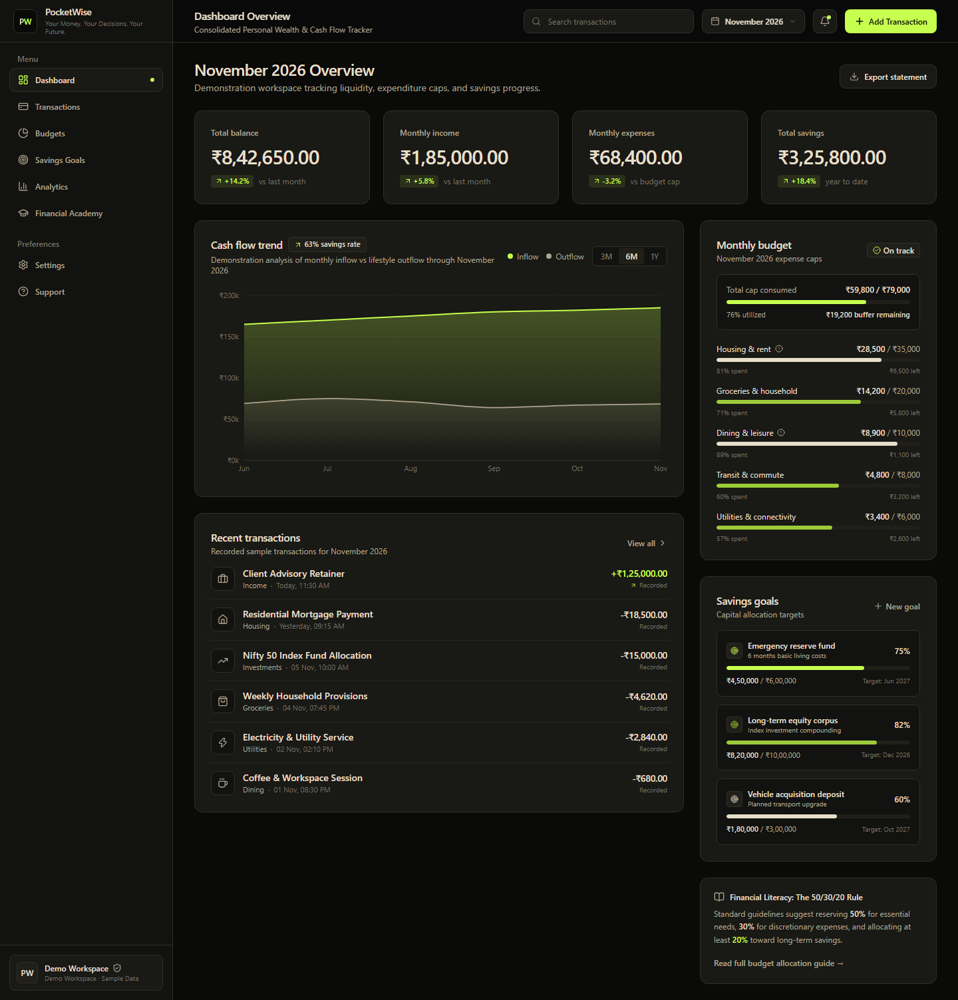
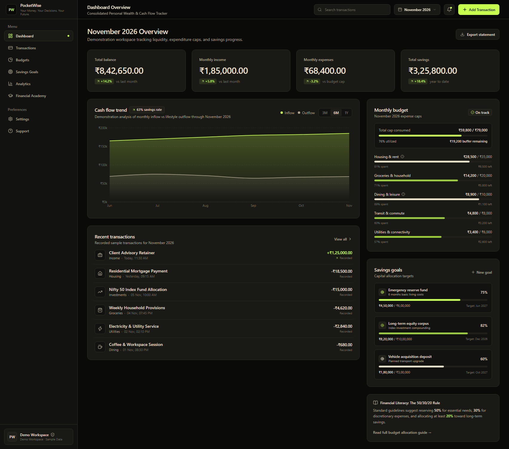
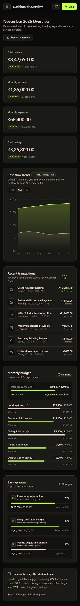

# PocketWise 2.0

> **Your Money. Your Decisions. Your Future.**

PocketWise 2.0 is a modern, client-side personal finance management and financial intelligence web application. Designed to bridge the gap between daily cash-flow organization and actionable financial literacy, PocketWise provides a comprehensive suite of financial tools—including multi-account net worth tracking, a multi-dimensional transaction ledger, real-time budget caps, milestone savings goals, scheduled recurring bills, safe-to-spend liquidity forecasting, interactive visual analytics, and an 11-category financial education academy.

The project currently operates as a self-contained, client-side demonstration application with offline-first persistence in browser `localStorage`, zero backend dependencies, and strict Indian Rupee (`INR - ₹`) monetary modeling using integer paise arithmetic.

---

## Table of Contents

- [About the Project](#about-the-project)
  - [The Problem](#the-problem)
  - [The Solution](#the-solution)
  - [Intended Audience](#intended-audience)
- [System Architecture](#system-architecture)
  - [Architecture Overview](#architecture-overview)
  - [Single Source of Truth](#single-source-of-truth)
  - [Data Flow Diagram](#data-flow-diagram)
- [Application Routes](#application-routes)
- [Core Features](#core-features)
  - [1. Dashboard Overview](#1-dashboard-overview)
  - [2. Accounts Management](#2-accounts-management)
  - [3. Transactions Ledger](#3-transactions-ledger)
  - [4. Monthly Budgets](#4-monthly-budgets)
  - [5. Savings Goals & Milestones](#5-savings-goals--milestones)
  - [6. Recurring Payments](#6-recurring-payments)
  - [7. Financial Planning & Safe-to-Spend](#7-financial-planning--safe-to-spend)
  - [8. Financial Analytics & Trends](#8-financial-analytics--trends)
  - [9. Financial Academy](#9-financial-academy)
- [Technology Stack](#technology-stack)
- [Financial Calculation Principles](#financial-calculation-principles)
- [Data Storage & Privacy](#data-storage--privacy)
- [Project Directory Structure](#project-directory-structure)
- [Getting Started](#getting-started)
  - [Prerequisites](#prerequisites)
  - [Installation & Setup](#installation--setup)
  - [Available Scripts](#available-scripts)
- [Testing & Quality Assurance](#testing--quality-assurance)
- [Screenshots & Visuals](#screenshots--visuals)
- [Current Development Status](#current-development-status)
- [Future Vision & Roadmap](#future-vision--roadmap)
- [Financial Disclaimer](#financial-disclaimer)
- [Acknowledgements & License](#acknowledgements--license)

---

## About the Project

### The Problem
Personal financial management is frequently fragmented across disconnected platforms:
- **Opaque Banking Portals:** Retail banking interfaces display raw account balances without contextualizing upcoming commitments, planned savings, or true discretionary spending power.
- **Fragile Spreadsheets:** Manual spreadsheets offer customizability but suffer from high manual overhead, broken formulas, and a lack of mobile responsiveness.
- **Enterprise Accounting Bloat:** Traditional accounting software is often cluttered with double-entry complexities and business-oriented jargon that overwhelm individual users.
- **The Financial Literacy Deficit:** Most finance tools track historical spending without educating users on fundamental financial principles, debt traps, or compounding growth.

### The Solution
PocketWise 2.0 addresses these challenges by uniting disciplined liquidity tracking with continuous financial education:
1. **Deterministic Liquidity Modeling:** The Safe-to-Spend formula prevents overdraft and lifestyle creep by calculating exact discretionary allowances after subtracting committed bills, savings targets, and an emergency reserve floor.
2. **Dynamic Cross-Entity Reactivity:** Balances, budget usage, analytics graphs, and savings progress update reactively from shared ledger records.
3. **Embedded Financial Academy:** A structured, 11-category curriculum with interactive quizzes connects theoretical personal finance concepts directly to practical management workflows.

### Intended Audience
- **Salaried Professionals:** Tracking monthly disposable income, managing lifestyle inflation, and planning index fund allocations.
- **Students & Early-Career Earners:** Learning budgeting frameworks (such as 50/30/20), credit score hygiene, and banking basics.
- **Household Budget Planners:** Monitoring recurring utility bills, groceries, and dedicated emergency funds.

---

## System Architecture

### Architecture Overview
PocketWise 2.0 utilizes a modular, client-side React architecture structured around a centralized state provider and decoupled domain utilities:

- **View Layer:** Functional React 19 components with Tailwind CSS v4 utility classes and Lucide React iconography.
- **Navigation Shell:** Declarative client-side routing via React Router DOM v7, providing deep links, route-driven header titles, and mobile navigation with body scroll locking.
- **State Layer (`DashboardContext`):** A centralized React Context acting as the single source of truth for accounts, transactions, budgets, goals, recurring schedules, and academy records.
- **Domain Business Logic:** Pure JavaScript utility modules isolated in `src/utils/` governing currency arithmetic, validation, filtering, and financial formulas.
- **Persistence Layer:** Versioned browser `localStorage` synchronization with automated schema fallbacks.

### Single Source of Truth
To ensure auditability and referential integrity:
- **Account Balances** are computed dynamically: `Opening Balance + Income - Expenses + Transfers In - Transfers Out`.
- **Budget Spending** is derived dynamically from expense transactions matching each category. Internal transfers (`type: 'transfer'`) alter account balances but do not count toward expenditure caps.
- **Net Worth** dynamically aggregates only active (non-archived) accounts.
- **Referential Safeguards:** An account cannot be deleted if transactions exist in the ledger that reference it; it must be archived instead.

### Data Flow Diagram

```mermaid
flowchart TD
    subgraph UI ["User Interface Layer"]
        R[React Router v7] --> P[Page Components]
        P --> L[DashboardLayout]
        L --> S[Sidebar & Header]
    end

    subgraph State ["Central State Layer"]
        C[DashboardContext Provider]
        H[useDashboard Hook]
        P <--> H
        H <--> C
    end

    subgraph Logic ["Domain Utilities (src/utils/)"]
        F1[transactions.js / toPaise]
        F2[accounts.js]
        F3[budgets.js]
        F4[planning.js / Safe-to-Spend]
        F5[recurring.js]
        F6[analytics.js]
        F7[academy.js]
        C --> Logic
    end

    subgraph Storage ["Browser Persistence"]
        LS[(Browser LocalStorage)]
        C <-->|Versioned JSON Keys| LS
    end
```

---

## Application Routes

PocketWise 2.0 provides 10 dedicated routes configured in [`src/App.jsx`](src/App.jsx):

| Module | Route | Component | Purpose |
| :--- | :--- | :--- | :--- |
| **Dashboard** | `/` | `Dashboard.jsx` | Consolidated financial overview, metrics, and cash flow chart |
| **Accounts** | `/accounts` | `Accounts.jsx` | Bank accounts, cash vaults, and net worth aggregation |
| **Transactions** | `/transactions` | `TransactionsPage.jsx` | Full transaction ledger, multi-filter, search, and CSV export |
| **Budgets** | `/budgets` | `BudgetsPage.jsx` | Monthly category expenditure caps and spending variance |
| **Savings Goals** | `/goals` | `SavingsGoalsPage.jsx` | Capital allocation milestones and contribution deposit ledger |
| **Recurring Payments** | `/recurring` | `RecurringPage.jsx` | Subscriptions, scheduled bills, and automated schedule advancement |
| **Financial Planning** | `/planning` | `FinancialPlanningPage.jsx` | Safe-to-Spend liquidity formula and emergency reserve planner |
| **Analytics** | `/analytics` | `AnalyticsPage.jsx` | Visual cash-flow trends, category distributions, and insights |
| **Financial Academy** | `/academy` | `AcademyPage.jsx` | 11-category financial education curriculum catalog |
| **Academy Lesson** | `/academy/:lessonId` | `LessonDetailsPage.jsx` | Lesson markdown prose, key takeaways, and interactive quizzes |

*Note: Any unmapped URL automatically redirects to `/` via a catch-all route.*

---

## Core Features

### 1. Dashboard Overview
- **Executive Metric Cards:** Total Balance, Monthly Inflow, Monthly Outflow, and Total Capital Saved.
- **Cash Flow Area Chart:** Recharts visualization comparing monthly income vs. expenses with 3M, 6M, and 1Y timeframe filters.
- **Recent Transactions:** Real-time search-filtered view of recent ledger activity with quick links to the full ledger.
- **Budget Health Bar:** High-level capacity meter showing overall monthly cap consumption.
- **Savings Goals Progress:** Real-time completion bars for top active goals.
- **Financial Literacy Card:** Contextual link to relevant Academy lessons (e.g., the 50/30/20 rule).

### 2. Accounts Management
- **Account Profiles:** Manage multiple accounts across types: Savings, Current, Cash Reserve, Investment, and Credit.
- **Consolidated Net Worth:** Live derivation summing positive liquid balances across active accounts.
- **Account History Drill-Down:** Clicking any account card opens an interactive drawer showing all associated transactions.
- **Archiving & Safety Deletion:** Accounts can be archived to exclude them from net worth calculations without destroying transaction history. Deletion is blocked if ledger transactions depend on the account.

### 3. Transactions Ledger
- **Complete CRUD Operations:** Create, edit, and delete transactions with title, amount, category, account, type, and date.
- **Transaction Types:** Income (`+`), Expense (`-`), and Account-to-Account Transfers (`↔`).
- **Multi-Dimensional Filtering:** Filter simultaneously by transaction type, 14 categories, specific accounts, and text search queries.
- **Sorting:** Order transactions by newest date, oldest date, highest amount, or lowest amount.
- **Real-Time Filtered Summary:** Instant totals bar calculating filtered inflow, outflow, and net balance.
- **RFC 4180 CSV Export:** Client-side CSV generation with field escaping and spreadsheet formula injection protection.

### 4. Monthly Budgets
- **Expense-Derived Consumption:** Category spent amounts are computed directly from matching expense transactions.
- **Utilization Threshold Badges:**
  - **Safe (< 80%):** Standard operational spending.
  - **Warning (80% – 100%):** Nearing expenditure ceiling.
  - **Exceeded (> 100%):** Highlighted with critical alerts displaying the exact overage amount.
- **Category Drill-Down:** Inspect all ledger transactions contributing to a category's monthly total.

### 5. Savings Goals & Milestones
- **Target Tracking:** Track current savings against milestone goals with percentage completion tracks.
- **Required Monthly Allocation:** Automated calculation determining the monthly contribution required to hit targets on schedule:
  $$\text{Required Monthly Deposit} = \frac{\text{Target Amount} - \text{Current Balance}}{\text{Months Remaining}}$$
- **Direct Deposit Ledger:** Log milestone deposits with custom notes and timestamps, preserving an auditable contribution history.

### 6. Recurring Payments
- **Multi-Frequency Support:** Weekly, monthly, quarterly, and yearly billing schedules.
- **One-Click "Mark as Paid":** Automatically logs a linked expense transaction into the primary ledger and advances the `nextDueDate` according to its frequency schedule.
- **Schedule Management:** Pause and resume active commitments without deleting historical records.
- **Normalized Outflow:** Computes the aggregate normalized monthly financial burden.

### 7. Financial Planning & Safe-to-Spend
- **Safe-to-Spend Discretionary Liquidity:** Deterministic formula isolating safe discretionary spending:
  $$\text{Discretionary} = \max(0, \text{Liquid Balance} - \text{Committed Bills} - \text{Planned Savings} - \text{Emergency Reserve})$$
- **Pacing Limits:** Recommends daily and weekly spending limits based on the remaining days in the billing cycle.
- **Emergency Reserve Protection:** Configurable reserve fund with quick presets for 3, 6, and 12 months of baseline living expenses.
- **Milestone Timeline:** Chronological roadmap forecasting goal completion dates.

### 8. Financial Analytics & Trends
- **Cash Flow Area Chart:** Monthly inflow vs outflow trends with gradient area fills.
- **Category Donut Chart:** Visual breakdown of expenditure across categories.
- **Spending by Account:** Horizontal bar chart displaying total debits per account.
- **Budget vs. Actual:** Grouped bar chart comparing allocated caps against actual consumption.
- **Deterministic Insights:** Rule-based insights highlighting savings rate performance and top expenditure categories without fabricated AI text.

### 9. Financial Academy
- **11 Curated Knowledge Domains:**
  1. Banking & Account Structures
  2. Personal Budgeting Frameworks
  3. Saving Fundamentals
  4. Investing Principles
  5. Mutual Funds & SIPs
  6. Stocks & ETFs
  7. Loans, EMIs & Debt Service
  8. Credit Cards & CIBIL Scores
  9. Retirement & Compounding
  10. Digital Payment Security
  11. Financial Fraud Awareness
- **Structured Lessons:** Read times, difficulty tiers, comprehensive prose, and bulleted Key Takeaways.
- **Interactive Knowledge Check:** Multiple-choice quiz modules with immediate scoring, 70% passing threshold, and pedagogical explanations.
- **Progress Tracking:** Lesson completion and bookmarking persisted to local storage.

---

## Technology Stack

PocketWise 2.0 is built exclusively on modern web standards and actively maintained packages:

| Category | Technology | Version | Description |
| :--- | :--- | :--- | :--- |
| **Core Framework** | React | `^19.3.1` | Component model and DOM rendering |
| **Build Tool** | Vite | `^8.3.6` | Fast development server and production bundler |
| **Language** | JavaScript (ESM) | ES2022+ | Modern ECMAScript module syntax |
| **Routing** | React Router DOM | `^7.18.5` | Declarative client-side routing |
| **Styling** | Tailwind CSS | `^4.3.5` | Modern CSS styling and design system |
| **Iconography** | Lucide React | `^1.70.0` | Clean, accessible vector icons |
| **Visualizations** | Recharts | `^3.10.1` | Declarative SVG charting library |
| **State Management** | React Context API | Native | Centralized reactive state with custom hooks |
| **Client Storage** | Browser LocalStorage | Native | Key-value browser persistence |
| **Unit Testing** | Node.js Test Runner | Native (`node:test`) | Fast, native unit test suite execution |
| **Code Quality** | ESLint | `^10.14.0` | Static analysis and linting rules |
| **E2E Testing** | Playwright (Python) | `^1.40+` | Cross-viewport browser automation |

---

## Financial Calculation Principles

To maintain fintech-grade reliability, PocketWise 2.0 adheres to strict mathematical guidelines:

1. **Integer Paise Arithmetic:**
   JavaScript floating-point arithmetic (`0.1 + 0.2 = 0.30000000000000004`) causes precision drift. All monetary calculations convert values to integer paise before addition, subtraction, or aggregation:
   $$\text{Paise} = \text{round}(\text{INR} \times 100), \quad \text{INR} = \frac{\text{Paise}}{100}$$

2. **Indian Rupee (`INR - ₹`) Formatting:**
   Numbers are formatted in accordance with the Indian numbering system using standard `en-IN` locales:
   - Thousands: `₹1,000`
   - Lakhs: `₹1,00,000`
   - Crores: `₹1,00,00,000`

3. **Internal Transfer Neutrality:**
   Transfers adjust the balances of source and destination accounts (`source -= amount`, `destination += amount`) but are strictly excluded from income, expense, and budget spending calculations.

4. **Spreadsheet Formula Injection Sanitization:**
   CSV exports sanitize fields beginning with dangerous spreadsheet execution prefixes (`=`, `+`, `-`, `@`) by prepending a single quote (`'`), preventing Formula Injection (CWE-1236).

---

## Data Storage & Privacy

PocketWise 2.0 operates with strict client-side data isolation:

- **Local Storage Engine:** All accounts, transactions, budgets, goals, and learning records reside entirely within the user's browser `localStorage` under versioned keys (`pocketwise_*_v2`).
- **Zero External Telemetry:** The application makes no external API requests, carries no third-party tracking scripts, and transmits no financial data across the network.
- **Session Continuity:** Data persists across browser refreshes and sessions within the same browser profile. Clearing browser site data resets the workspace to default sample data.
- **No Cross-Device Synchronization:** Data is stored locally on the specific device and browser in use.
- **Security Notice:** PocketWise is an offline demonstration application. Users must never input actual net-banking passwords, debit/credit card PINs, CVVs, or sensitive government credentials.

---

## Project Directory Structure

```
pocketwise/
├── src/
│   ├── assets/               # Static images and brand marks
│   ├── components/           # Reusable UI components
│   │   ├── AddTransactionModal.jsx
│   │   ├── BudgetOverview.jsx
│   │   ├── CashFlowChart.jsx
│   │   ├── Header.jsx
│   │   ├── NewSavingsGoalModal.jsx
│   │   ├── NotificationToast.jsx
│   │   ├── RecentTransactions.jsx
│   │   ├── SavingsGoals.jsx
│   │   ├── Sidebar.jsx
│   │   └── StatCard.jsx
│   ├── context/              # Central state management
│   │   ├── context.js
│   │   ├── DashboardContext.jsx
│   │   └── useDashboard.js
│   ├── data/                 # Demonstration datasets and curriculum
│   │   ├── academyData.js
│   │   └── dashboardData.js
│   ├── layouts/              # Shared responsive layouts
│   │   └── DashboardLayout.jsx
│   ├── pages/                # Primary routed view components
│   │   ├── AcademyPage.jsx
│   │   ├── Accounts.jsx
│   │   ├── AnalyticsPage.jsx
│   │   ├── BudgetsPage.jsx
│   │   ├── Dashboard.jsx
│   │   ├── FinancialPlanningPage.jsx
│   │   ├── LessonDetailsPage.jsx
│   │   ├── RecurringPage.jsx
│   │   ├── SavingsGoalsPage.jsx
│   │   └── TransactionsPage.jsx
│   ├── utils/                # Domain logic, formulas, and formatters
│   │   ├── academy.js
│   │   ├── accounts.js
│   │   ├── analytics.js
│   │   ├── budgets.js
│   │   ├── chartTimeframe.js
│   │   ├── csvExport.js
│   │   ├── formatters.js
│   │   ├── planning.js
│   │   ├── recurring.js
│   │   ├── savingsGoals.js
│   │   └── transactions.js
│   ├── App.css               # Root layout styles
│   ├── App.jsx               # Route definitions and provider tree
│   ├── index.css             # Tailwind CSS imports
│   └── main.jsx              # React application entry point
├── test/                     # Unit and E2E test suites
│   ├── academy.test.js
│   ├── accounts.test.js
│   ├── analytics.test.js
│   ├── budgets.test.js
│   ├── chartTimeframe.test.js
│   ├── csv.test.js
│   ├── e2e.py                # Playwright end-to-end verification
│   ├── financialPlanning.test.js
│   ├── formatters.test.js
│   ├── recurring.test.js
│   ├── savingsGoals.test.js
│   └── transactions.test.js
├── scripts/                  # Automated verification scripts & screenshots
│   └── screenshots/          # Application screenshot captures
├── index.html                # Single-page HTML shell
├── package.json              # Project dependencies and script runner
├── vite.config.js            # Vite build configuration
└── eslint.config.js          # ESLint configuration
```

---

## Getting Started

### Prerequisites
Before running the application locally, ensure your environment has:
- **Node.js:** v18.0.0 or higher (v20+ recommended)
- **npm:** v9.0.0 or higher
- **Git:** Installed and configured

### Installation & Setup

1. **Clone the repository:**
   ```bash
   git clone https://github.com/prajwalkhatavakar25/pocketwise.git
   cd pocketwise
   ```

2. **Install project dependencies:**
   ```bash
   npm install
   ```

3. **Start the local development server:**
   ```bash
   npm run dev
   ```
   Open `http://localhost:5173` in your browser to view the application with Hot Module Replacement (HMR).

### Available Scripts

| Command | Action |
| :--- | :--- |
| `npm run dev` | Starts the Vite development server on `http://localhost:5173` |
| `npm run build` | Compiles an optimized, production-ready bundle into the `dist/` directory |
| `npm run preview` | Starts a local web server to preview the production build |
| `npm run lint` | Runs ESLint across all source and test files to check code quality |
| `npm test` | Executes the native Node.js unit test suite across all 11 test modules |

*Deployment Note: The live GitHub Pages deployment currently encounters a known client-side routing and asset initialization issue that is under active investigation. For reliable evaluation, run the application locally via `npm run dev` or `npm run preview`.*

---

## Testing & Quality Assurance

PocketWise 2.0 maintains a comprehensive test suite covering mathematical formulas, business rules, and responsive browser rendering.

### Implementation Verification Results (Phase 2 Freeze)
- **Unit Tests:** **40 passing tests across 11 suites** running in `~230ms` via Node.js native test runner (`node:test`).
  - Account validation, balance calculations, and net worth aggregation.
  - Transactions ledger filtering, search, and integer paise arithmetic.
  - Budget spending derivation and alert threshold boundaries.
  - Savings goal completion and monthly allocation formulas.
  - Recurring payment schedule advancement and automated transaction generation.
  - Safe-to-Spend liquidity calculation and constraint clamping.
  - Financial analytics metrics and deterministic insight generators.
  - Financial academy quiz scoring and progress calculation.
  - RFC 4180 CSV serialization and formula injection sanitization.
  - Chart timeframe dataset slicing.
  - INR currency formatters and percentage sign indicators.
- **Static Analysis:** **0 errors and 0 warnings** under strict ESLint rules (`npm run lint`).
- **Production Build:** Successfully compiled with Vite 8 (`npm run build`).
- **End-to-End Suite (`test/e2e.py`):** Verified using Playwright Chromium across three viewport tiers:
  - Desktop (`1440 × 900`)
  - Tablet (`768 × 1024`)
  - Mobile (`390 × 844`)
- **Console Health:** **0 console errors** or uncaught runtime exceptions during the verification run.

---

## Screenshots & Visuals

The application interface follows a dark fintech aesthetic utilizing Deep Black (`#0A0A09`), Warm Beige (`#E8DFC9`), and Neon Lime (`#C6FF4D`):

### Desktop Dashboard Overview (1440 × 900)


### Ultrawide Monitor Layout (1704 × 900)


### Mobile Drawer Navigation (390 × 844)


---

## Current Development Status

PocketWise development is executed in controlled, verified phases. The application is currently frozen at **Phase 2 Complete**.

```
[✓] Phase 1: Functional Single-Page Dashboard
[✓] Phase 2: Complete Core Multi-Page Application (Tag: v2.0-phase2-freeze)
[ ] Phase 3: Notification Centre, Platform Settings & Help Desk
[ ] Phase 4: Supabase Backend Integration & Cloud Authentication
[ ] Phase 5: PocketWise AI Financial Coach (Gemini API)
[ ] Phase 6: AutoTrack SMS & Receipt Ingestion
[ ] Phase 7: Machine Learning Models & Production Hardening
```

- **Completed (Phases 1 & 2):** Fully functional client-side application covering Dashboard, Accounts, Transactions, Budgets, Savings Goals, Recurring Payments, Financial Planning, Analytics, and Financial Academy with LocalStorage persistence.
- **Upcoming (Phase 3):** Notification inbox with real-time budget threshold alerts, customizable workspace settings (currency, number format, JSON export/restore), and an interactive support desk.

---

## Future Vision & Roadmap

The long-term vision for PocketWise extends beyond manual tracking into proactive financial intelligence:

- **AI-Powered Financial Explanations (Phase 5):** Contextual explanations of spending spikes and budget variances powered by the Gemini API.
- **Automated Categorization (Phase 6):** Machine-learning models capable of auto-categorizing expenses from uploaded statements or receipts.
- **Time-Series Cash Flow Forecasting (Phase 7):** Predictive models projecting balance trajectories and alerting users to impending liquidity shortfalls weeks in advance.
- **Open Banking Integration:** Secure, read-only account aggregation via the RBI Account Aggregator (AA) framework to eliminate manual data entry.

---

## Financial Disclaimer

PocketWise 2.0 is an educational and personal financial organization demonstration application. 

- **Not Financial Advice:** PocketWise does not offer certified investment, tax, or legal advice. Calculations (such as Safe-to-Spend and required monthly savings) are heuristic estimations for planning purposes only.
- **No Direct Financial Transactions:** The application does not connect to live banking networks, initiate fund transfers, execute trades, or process payments.
- **User Responsibility:** Users should independently evaluate financial decisions and consult certified financial planners or tax advisors for professional guidance.

---

## Acknowledgements & License

### Acknowledgements
PocketWise is built using open-source libraries and developer tools:
- [React](https://react.dev/) by Meta
- [Vite](https://vite.dev/) by Evan You & the Vite Core Team
- [Tailwind CSS](https://tailwindcss.com/) by Tailwind Labs
- [Lucide Icons](https://lucide.dev/) by the Lucide Community
- [Recharts](https://recharts.org/) by the Recharts Group

### License
No explicit open-source license has been added to this repository yet. All rights are reserved by the repository owner ([@prajwalkhatavakar25](https://github.com/prajwalkhatavakar25)).
